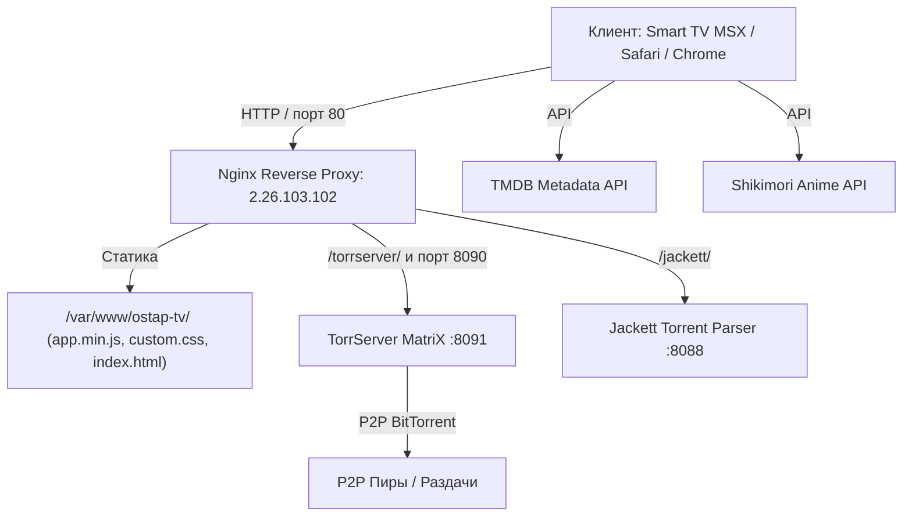

# OSTAP TV — Премиальный мультимедийный кинотеатр

<p align="center">
  
</p>

<p align="center">
  <b>OSTAP TV</b> — современный веб- и Smart TV кинотеатр в премиальном стиле <i>Golden Cinema</i> (глубокий обсидиан <code>#090A0D</code> + благородное золото <code>#D4AF37</code>), созданный для комфортного просмотра фильмов, сериалов и аниме в 4K/HDR без задержек.
</p>

---

## 🌟 Ключевые возможности

* 🎬 **Каталог мирового кино и сериалов:** интеграция с TMDB, рейтинги Кинопоиск / IMDB, трейлеры, подборки и рекомендации.
* ⚡ **Мгновенный торрент-стриминг (P2P):** интеграция с высокоскоростным TorrServer MatriX и Jackett для прямого воспроизведения раздач на лету без необходимости предварительного скачивания.
* 🎧 **Умный селектор аудиодорожек:** переключение дорожек, поддержка многоканального звука Dolby Digital AC-3 / E-AC-3 5.1, нативный запуск во внешних плеерах (IINA, VLC) и поддержка аппаратного декодирования в Apple Safari.
* 🌸 **Раздел Аниме:** прямая синхронизация с базой Shikimori.
* 📺 **Мультиплатформенность:**
  * **Smart TV:** Samsung Tizen, LG webOS, Philips, Sony, Android TV через приложение **Media Station X (MSX)**.
  * **Десктоп:** macOS (Safari, Chrome), Windows, Linux.
  * **Мобильные устройства:** iOS (PWA / Safari), Android.

---

## 🚀 Быстрый запуск

### 1. Просмотр в веб-браузере (ПК / Mac / Ноутбук)
Перейдите по прямому адресу сервера:
```
http://2.26.103.102/
```
> **Совет для пользователей Mac:** Для фильмов со звуком Dolby Digital (AC-3/EAC3 5.1) открывайте сервис в **Safari** — в браузере Apple поддерживается аппаратное декодирование звука из коробки. Также прямо в плеере доступен запуск в один клик через плееры **IINA** или **VLC**.

---

### 2. Запуск на телевизоре через Media Station X (MSX)
1. Установите приложение **Media Station X** на Smart TV (доступно в магазинах приложений Samsung Smart Hub, LG Content Store, Google Play TV).
2. Откройте **Settings -> Start Parameter -> Setup**.
3. Введите стартовый параметр:
   ```
   2.26.103.102/msx/start.json
   ```
4. Нажмите **Validate** и подтвердите запуск **OSTAP TV**.

---

## 🏗 Архитектура проекта



Подробное описание архитектуры, API и структуры кода читайте в [ARCHITECTURE.md](file:///Users/macbook13pro/Downloads/Media%20station%20x/ARCHITECTURE.md).

---

## 📂 Структура репозитория

```
├── index.html              # Главная точка входа, инициализация платформы и кэш-бастер
├── app.min.js              # Основное ядро плеера, навигации, контроллеров и UI
├── css/
│   ├── app.css             # Базовые стили приложения
│   └── custom.css          # Премиальная дизайн-система OSTAP TV (Golden Cinema)
├── plugins/
│   └── ostap.js            # Фирменный плагин расширений OSTAP TV
├── msx/
│   └── start.json          # Конфигурация запуска для Media Station X
├── icons/                  # Фирменные иконки и фавиконки OSTAP TV
├── docs/                   # Полная документация проекта
│   ├── ARCHITECTURE.md     # Архитектура и сетевые потоки
│   ├── DESIGN_SYSTEM.md    # Дизайн-токены, цвета и анимации
│   ├── DEPLOYMENT.md       # Инструкция по деплою и настройке VPS
│   └── HANDOFF.md          # Руководство по дальнейшему развитию для AI/разработчиков
└── README.md               # Главный файл описания
```

---

## 📚 Документация для разработчиков и AI

* 📐 **[Архитектура и потоки данных](docs/ARCHITECTURE.md)** — схемы взаимодействия, компоненты ядра, контроллеры и плеер.
* 🎨 **[Дизайн-система Golden Cinema](docs/DESIGN_SYSTEM.md)** — палитра обсидиан/золото, типографика, правила трансформации панелей.
* 🚀 **[Деплой и инфраструктура VPS](docs/DEPLOYMENT.md)** — Nginx, TorrServer, Jackett, порты, CORS и кэширование.
* 🤖 **[Руководство по передаче проекта (Handoff)](docs/HANDOFF.md)** — текущий статус, решенные проблемы, важные нюансы и бэклог задач для следующей AI-модели.
