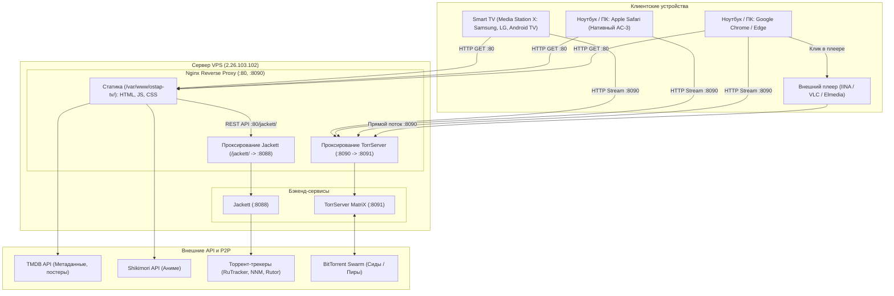
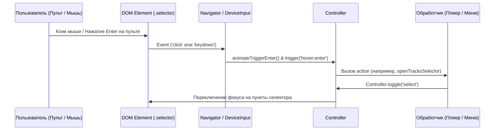

# Архитектура проекта OSTAP TV

Документ описывает техническую архитектуру клиентской части, серверной инфраструктуры, сетевых протоколов и аудио-видео пайплайна **OSTAP TV**.

---

## 1. Общая диаграмма системы



---

## 2. Клиентская архитектура (Фронтенд)

Фронтенд построен как высокопроизводительное Single Page Application (SPA) на чистом JavaScript (ES5/ES6) без тяжелых фреймворков для мгновенного отклика на телевизорах со слабыми процессорами (Tizen 3.0+, webOS 3.0+, WhaleTV, Android TV 7+).

### 2.1. Главные компоненты ядра (`app.min.js`)

| Модуль | Роль в системе |
| :--- | :--- |
| `Navigator` | Пространственная навигация (Spatial Navigation) с пульта ДУ (D-pad: Up, Down, Left, Right, OK, Back) и привязка событий мыши / тачпада |
| `Controller` | Стек активных контекстов управления (`content`, `player_panel`, `select`, `modal`, `settings`). Управляет фокусом и возвратом |
| `Player` | Глобальный фасад медиаплеера: управление воспроизведением, субтитрами, дорожками и метаданными текущего медиафайла |
| `PlayerVideo` | Низкоуровневая обертка над HTML5 `<video>`, webOS Luna API и Tizen AVPlay API |
| `PlayerPanel` | Нижняя панель управления воспроизведением (таймлайн, перемотка, кнопки, регулятор громкости) |
| `Select` | Модальные боковые панели (селектбоксы) для выбора дорожек, качества, источников и настроек |
| `Torserver` | Клиент для работы с TorrServer API (добавление раздачи по Magnet/Хэшу, получение списка файлов, генерация stream URL) |
| `Activity` | Менеджер экранов приложения (каталог, карточка фильма, поиск, торренты) |

### 2.2. Событийная модель взаимодействия с устройствами



---

## 3. Серверная инфраструктура (`2.26.103.102`)

### 3.1. Nginx Reverse Proxy
* **Порт 80:** Основной веб-сервер, раздающий статику OSTAP TV из директории `/var/www/ostap-tv/`.
* **Порт 8090:** Выделенный прокси-порт для потоков TorrServer с полным набором CORS-заголовков (`Access-Control-Allow-Origin: *`, поддержка preflight OPTIONS 204).
* **Location `/jackett/`:** Проксирует запросы на локальный демон Jackett (`127.0.0.1:8088/jackett/`) с кэшированием поисковых ответов.
* **Location `/torrserver/`:** Прямой доступ к API TorrServer на порту 80.
* **Кэширование:** Отключено для `.js` и `.css` файлов (`no-store, no-cache, must-revalidate`), чтобы пользователи на ТВ и ПК всегда получали самые актуальные сборки.

### 3.2. TorrServer MatriX (`:8091` -> `:8090`)
* Высокопроизводительный движок на Go для стриминга торрентов.
* Скачивает только те чанки, которые требуются плееру прямо сейчас (последовательное чтение).
* Формирует непрерывный HTTP-поток по адресу:
  ```
  http://2.26.103.102:8090/stream/<filename>?link=<torrent_hash>&index=<file_id>
  ```

---

## 4. Пайплайн воспроизведения звука и видео

### 4.1. Проблема кодеков в браузерах на ноутбуках
Большинство фильмов в 1080p и 4K упакованы с аудиодорожками **AC-3 (Dolby Digital)** и **E-AC-3 (Dolby Digital Plus 5.1)**.
* **Google Chrome / Edge на ПК/Mac:** не содержат аппаратных декодеров AC-3/EAC3 из-за лицензионных ограничений Dolby Laboratories. Chrome декодирует видео, но звук отсутствует.
* **Apple Safari на macOS:** содержит нативный декодер Dolby через macOS AVFoundation. Тот же самый фильм воспроизводится со звуком прямо в браузере.
* **Smart TV:** все современные телевизоры LG, Samsung, Sony и Android TV имеют аппаратные чипы декодирования Dolby AC-3, поэтому на ТВ звук всегда есть.

### 4.2. Механизм выбора дорожек и запуск внешних плееров
В модуле `openTracksSelector` (`app.min.js`) реализован гибридный подход:
1. Опрос доступных аудиодорожек HTML5 `<video>.audioTracks` и структуры метаданных торрента.
2. Мгновенное открытие бокового меню выбора дорожек без искусственных блокирующих задержек.
3. Для пользователей ноутбуков формируются альтернативные действия:
   * **Safari:** `window.open(url, '_blank')`
   * **IINA:** URI-схема `iina://weblink?url=<encoded_stream_url>`
   * **VLC:** URI-схема `vlc://<raw_stream_url>`
   * **Буфер обмена:** `navigator.clipboard.writeText(stream_url)`

---

## 5. Интеграция с Media Station X (MSX)

* Конфигурационный файл расположен в `msx/start.json`.
* Стартовый параметр для настройки ТВ:
  ```
  2.26.103.102/msx/start.json
  ```
* Запускает страницу `http://2.26.103.102/index.html` во встроенном Chromium-движке ТВ с автоматической подгрузкой `plugins/ostap.js` и адаптацией под разрешение 1080p / 4K.
